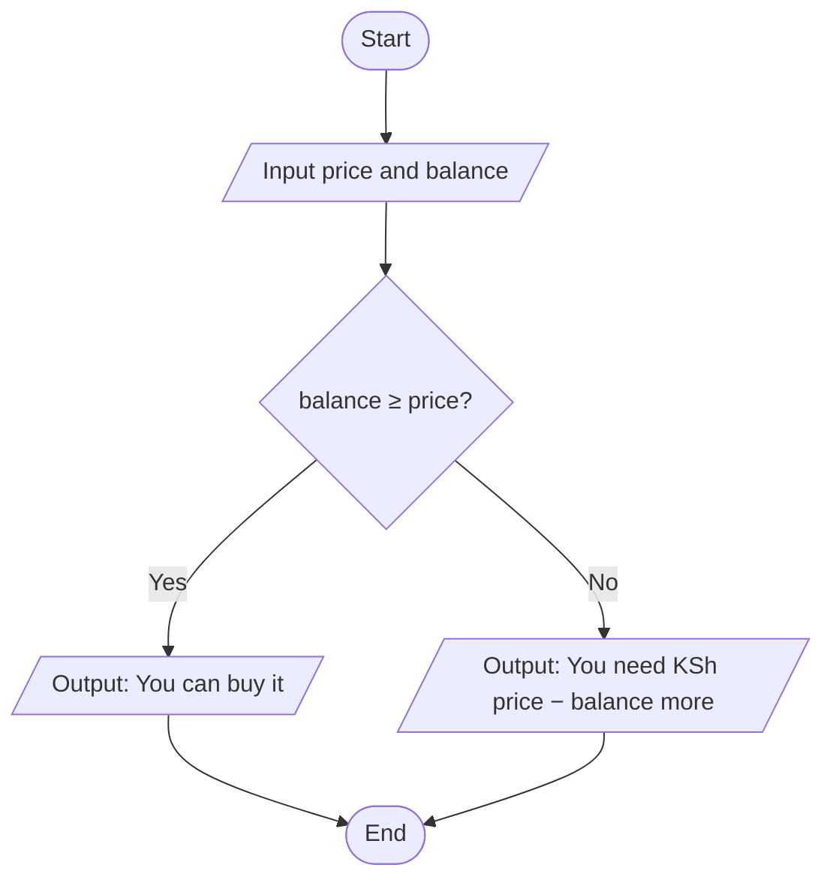
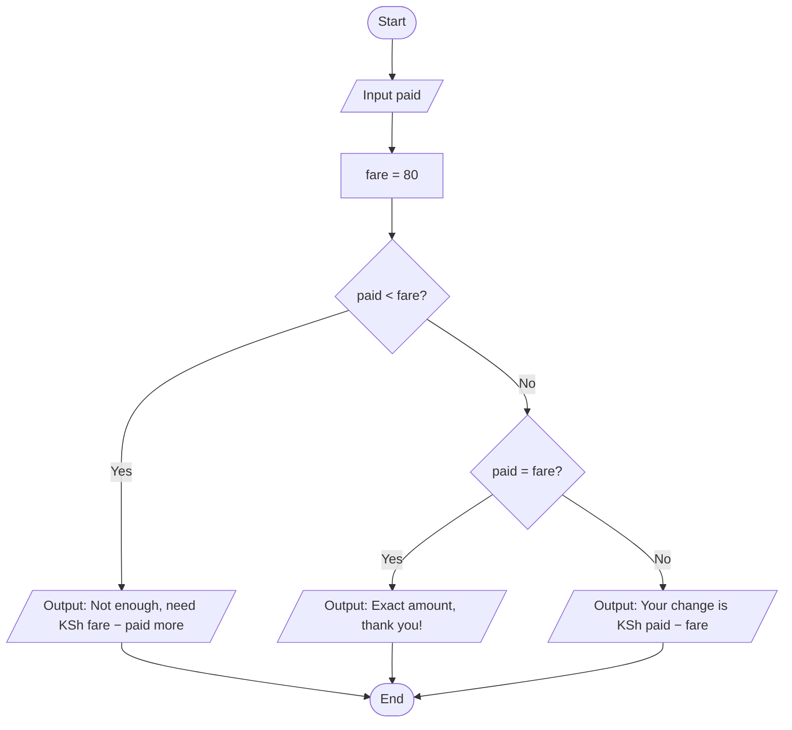

# Guide 03 · Thinking like a programmer: algorithms

Most of programming happens **before** you type any code. A programmer's real job is to turn a fuzzy problem into a clear, ordered set of steps. That set of steps is called an **algorithm**.

> **Algorithm:** a finite, ordered list of unambiguous steps that solves a problem.

A recipe is an algorithm. So are the directions to your house, the steps to register a SIM card, and the rules for calculating your final grade.

## The four habits of computational thinking

| Habit | What it means | Example: "Plan a class trip to Lake Nakuru" |
|-------|---------------|---------------------------------------------|
| **1. Decomposition** | Break a big problem into smaller ones | Transport, food, budget, permission letters |
| **2. Pattern recognition** | Notice what's similar to problems you've solved | Budgeting is like last year's trip, just with new prices |
| **3. Abstraction** | Ignore details that don't matter, keep what does | The bus colour doesn't matter; the number of seats does |
| **4. Algorithm design** | Write the step-by-step solution | 1. Count students. 2. Get 3 bus quotes. 3. Pick the cheapest with enough seats… |

## What makes a *good* algorithm?

A good algorithm is:

1. **Unambiguous**: each step has one meaning. ❌ "Add some salt" ✅ "Add 1 teaspoon of salt".
2. **Ordered**: the steps happen in a sensible order. You can't pour the tea before boiling the water.
3. **Finite**: it ends. ❌ "Keep stirring." ✅ "Stir until smooth, or for at most 5 minutes."
4. **Complete**: it handles the unusual cases too. What if the shop is out of milk? What if the M-Pesa balance is too low?
5. **Has clear input and output**: you know what it needs and what it produces.

## Writing algorithms: three tools

### 1. Numbered steps (plain English)

> **Problem:** Decide whether a customer can afford an item.
>
> 1. Get the item price.
> 2. Get the customer's M-Pesa balance.
> 3. If the balance is greater than or equal to the price, say "You can buy it".
> 4. Otherwise, say "You need KSh X more", where X is price minus balance.

### 2. Pseudocode (half English, half code)

Pseudocode is not a real language. It's a sketch that's easy to turn into Python later.

```
INPUT price
INPUT balance
IF balance >= price THEN
    OUTPUT "You can buy it"
ELSE
    OUTPUT "You need KSh", price - balance, "more"
END IF
```

### 3. Flowcharts

A **flowchart** is a picture of an algorithm. Each kind of step has its own shape, and arrows show the order. Flowcharts are great for spotting a missing "otherwise" before you write any code.

| Shape | Name | Meaning | Example |
|-------|------|---------|---------|
| Oval (rounded ends) | **Start / End** | Where the algorithm begins and finishes | Start |
| Parallelogram ▱ | **Input / Output** | Data comes in, or a result goes out | Input price |
| Rectangle ▭ | **Process** | An action or calculation | change = paid − fare |
| Diamond ◇ | **Decision** | A yes/no question with exactly two exits | balance ≥ price? |
| Arrow → | **Flow line** | The order of the steps | |

**Rules:** one Start and one End · read top to bottom, left to right · every diamond has a **Yes** and a **No** exit · every path must reach End.

Here is the "can the customer afford it?" algorithm as a flowchart (GitHub draws it for you):



<details>
<summary>Can't see the drawing? (for example in Colab or a PDF) Here is a text version.</summary>

```
              ( START )
                  │
                  ▼
      /  Input price and balance  /
                  │
                  ▼
          ◇ balance ≥ price? ◇
           │ Yes          │ No
           ▼              ▼
 / Output: "You can  /   / Output: "You need KSh  /
 /   buy it"         /   /  price − balance more" /
           │              │
           └──────┬───────┘
                  ▼
               ( END )
```
</details>

And here is the same algorithm in Python. Don't worry about understanding every symbol yet. You'll write this yourself in Session 2. Notice how closely it follows the pseudocode:

```python
price = 450
balance = 300

if balance >= price:
    print("You can buy it")
else:
    print("You need KSh", price - balance, "more")
```

## Worked example: making change

> **Problem:** A matatu fare is KSh 80. Given the note a passenger pays with, work out the change.

**Decompose:** what are the inputs (fare, amount paid) and outputs (change, or a message if not enough)?

**Edge cases:** What if they pay exactly KSh 80? What if they pay KSh 50?

**Algorithm:**

1. Set the fare to 80.
2. Ask how much the passenger paid.
3. If paid is less than the fare, say "Not enough. You need KSh (fare − paid) more" and stop.
4. Otherwise, change = paid − fare.
5. If change is 0, say "Exact amount, thank you!"
6. Otherwise, say "Your change is KSh (change)".

**Test it with examples (a "dry run"):**

| Paid | Expected output |
|------|-----------------|
| 100 | Your change is KSh 20 |
| 80 | Exact amount, thank you! |
| 50 | Not enough. You need KSh 30 more |
| 1000 | Your change is KSh 920 |

**The same algorithm as a flowchart.** It has two decisions, so there are three possible outputs, and every path ends at End:



Trace each test case through the flowchart with your finger. Paid 50: *paid #lt; fare?* **Yes**, so "need KSh 30 more". Paid 80: **No**, then *paid = fare?* **Yes**, so "exact amount". Paid 100: **No**, **No**, so change is KSh 20.

Testing your algorithm by hand before coding catches most mistakes early. Professional programmers call these **test cases**.

## Common beginner traps

- **Assuming knowledge.** The computer doesn't know a week has 7 days unless you say so.
- **Forgetting the "otherwise".** Every `if` raises the question: what happens if not?
- **Never-ending loops.** "Keep asking until the PIN is right" needs a limit: after 3 wrong tries, lock the account.
- **Doing too much in one step.** "Calculate the results" is not a step; it's a whole algorithm.

Now go to the hands-on activity: [../worksheets/recipe-worksheet.md](../worksheets/recipe-worksheet.md)

Next guide: [04-why-code-in-the-age-of-ai.md](04-why-code-in-the-age-of-ai.md)
